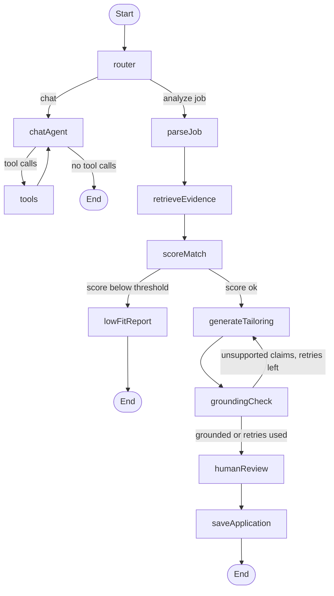

# 🚀 CareerPilot — An AI Job Applications Assistant

CareerPilot reads your resume, compares it with a job post, and writes tailored resume bullets and a cover letter that only use facts found in your resume. You review every draft before it is saved, and you track your applications in one place.

It is a full-stack AI agent project built with **LangGraph (TypeScript)**, **RAG over Qdrant**, **Express**, **MongoDB**, and **Next.js**.

<!-- Add screenshots here. Upload them to a docs/ folder in the repo, then:


-->

## ✨ What it does

- 📄 **Upload your resume (PDF).** It is parsed, split into section-aware chunks, embedded, and stored in Qdrant.
- 🎯 **Paste a job post.** The agent extracts the requirements, searches your resume for evidence for each one, and scores the match.
- ✍️ **Get a grounded draft.** Resume bullets and a cover letter are written from retrieved evidence only. A second pass fact-checks every claim and sends the draft back for a rewrite if something is unsupported.
- 👀 **Review before saving.** The graph pauses for human approval. The review screen marks each requirement like a highlighter pass: green for covered, yellow for partial, a red wavy underline for missing.
- 💬 **Chat about your own experience.** Ask things like "Which of my projects shows backend work best?" and the agent searches your resume with tools.
- 📊 **Track applications.** Saved drafts land in a tracker where you update the status (saved, applied, interview, rejected, offer).
- 💾 **Conversations persist.** Chat history is stored in MongoDB, so you can come back to any thread.

## 🧠 How it works

The whole agent is one LangGraph graph. A router decides whether a message is a normal chat or a job post to analyze.



### ⚙️ Graph nodes

| Node | Type | What it does |
|---|---|---|
| `router` | LLM, structured output | Classifies the message as chat or job analysis |
| `chatAgent` and `tools` | LLM with tools | Answers questions using `searchCareerData`, `listApplications`, `updateApplicationStatus`, and optional web search |
| `parseJob` | LLM, structured output | Extracts title, company, and requirements from the post |
| `retrieveEvidence` | Plain code | Queries Qdrant once per requirement, filtered by user |
| `scoreMatch` | LLM labels, code scores | The LLM marks each requirement covered, partial, or missing. The percentage is calculated in code |
| `generateTailoring` | LLM | Writes bullets and a cover letter from the evidence only |
| `groundingCheck` | LLM as fact-checker | Flags claims not supported by the resume and triggers up to 2 retries |
| `humanReview` | `interrupt()` | Pauses the graph until the user approves or discards |
| `saveApplication` | Plain code | Writes the application to MongoDB |

### 💡 Design decisions worth knowing

- 🛡️ **Grounding over fluency.** The most important risk in a resume tool is invented experience. Generation is restricted to retrieved evidence, and a separate check verifies it.
- 🧮 **The LLM never does arithmetic.** It only labels requirements. The match score is computed in code.
- 🔐 **The model never chooses the user ID.** `userId` comes from the verified login and travels in the run config, so tools cannot be talked into reading someone else's data.
- 🔄 **State persists between messages.** The router resets the analysis fields whenever a new analysis starts, so one job never inherits another's retry count or draft.
- 🙋 **Human in the loop.** Nothing is saved until the user approves it.

## 🛠️ Tech stack

| Area | Technology |
|---|---|
| 🤖 Agent | LangGraph and LangChain (TypeScript), Groq (`openai/gpt-oss-120b`) |
| 🔎 RAG | `unpdf` for parsing, `@langchain/textsplitters`, Gemini `gemini-embedding-001` (768 dimensions), Qdrant |
| ⚡ API | Node.js, Express, Zod, Mongoose, Server-Sent Events for streaming |
| 💾 Memory | MongoDB with the LangGraph MongoDB checkpointer |
| 🎨 Frontend | Next.js (App Router), Tailwind CSS v4, Zustand, `react-markdown` |
| 🔑 Auth | Clerk (social login only) |
| 🛡️ Protection | `helmet`, per-user rate limits, a daily message quota |

## 📁 Project structure

```text
job-agent/
├── docker-compose.yml        # Qdrant and MongoDB for local development
├── apps/
│   ├── api/
│   │   ├── src/
│   │   │   ├── graph/        # state, schemas, main graph, streaming
│   │   │   ├── nodes/        # router, chatAgent, analysis nodes
│   │   │   ├── tools/        # tools the chat agent can call
│   │   │   ├── rag/          # PDF parsing, chunking, embeddings, Qdrant
│   │   │   ├── models/       # Mongoose models
│   │   │   ├── routes/       # resume, chat, threads, applications
│   │   │   ├── lib/          # env, LLM, auth limits, helpers
│   │   │   └── scripts/      # ingest, chat (CLI), evals
│   │   └── evals/            # test cases and job posts for evals
│   └── web/
│       ├── app/              # pages (chat, applications, resume, sign-in)
│       ├── components/       # chat, review sheet, tracker, uploader
│       ├── lib/              # API client and SSE stream reader
│       └── store/            # Zustand chat store
```

## 🚀 Getting started

### 📋 Prerequisites

- Node.js 20 or newer
- Docker (for MongoDB and Qdrant)
- API keys:
  - [Groq](https://console.groq.com) for the LLM
  - [Google AI Studio](https://aistudio.google.com/apikey) for embeddings
  - [Clerk](https://dashboard.clerk.com) for login (enable the social providers you want)
  - Tavily for web search (optional)

### 1️⃣ Clone and start the databases

```bash
git clone https://github.com/<your-username>/<your-repo>.git
cd <your-repo>
docker compose up -d
```

Qdrant's dashboard is at http://localhost:6333/dashboard.

### 2️⃣ Run the API

```bash
cd apps/api
npm install
cp .env.example .env     # then fill in your keys (use "copy" on Windows cmd)
npm run dev
```

Check http://localhost:4000/health. Both `mongo` and `qdrant` should be `true`.

### 3️⃣ Run the web app

```bash
cd apps/web
npm install
```

Create `apps/web/.env.local` (see the table below), then:

```bash
npm run dev
```

Open http://localhost:3000, sign in, upload your resume on the Resume page, and paste a job post in Chat.

### 🔐 Environment variables

**`apps/api/.env`**

| Variable | Purpose |
|---|---|
| `PORT` | API port, default 4000 |
| `MONGODB_URI` | for example `mongodb://localhost:27017/job_agent` |
| `QDRANT_URL` | for example `http://localhost:6333` |
| `QDRANT_API_KEY` | only for Qdrant Cloud |
| `GROQ_API_KEY` | LLM |
| `GOOGLE_API_KEY` | embeddings |
| `TAVILY_API_KEY` | optional web search |
| `CLERK_PUBLISHABLE_KEY` and `CLERK_SECRET_KEY` | verify logins |
| `WEB_ORIGIN` | the web app's address, for CORS |
| `DAILY_MESSAGE_LIMIT` | messages per user per day, default 50 |

**`apps/web/.env.local`**

| Variable | Purpose |
|---|---|
| `NEXT_PUBLIC_API_URL` | for example `http://localhost:4000` |
| `NEXT_PUBLIC_CLERK_PUBLISHABLE_KEY` and `CLERK_SECRET_KEY` | Clerk |
| `NEXT_PUBLIC_CLERK_SIGN_IN_URL` | `/sign-in` |
| `NEXT_PUBLIC_CLERK_SIGN_IN_FALLBACK_REDIRECT_URL` | `/chat` |

> ⚠️ Never commit `.env` files or your resume. The `data` folder is git-ignored.

## 🔌 API

All `/api` routes require a signed-in user (Clerk token in the `Authorization` header).

| Endpoint | Description |
|---|---|
| `POST /api/resume` | Upload a PDF (multipart field `file`) |
| `GET /api/resume` | List uploaded resumes |
| `POST /api/chat` | Send a message, streamed back as Server-Sent Events |
| `POST /api/chat/:threadId/review` | Approve or discard a pending draft (`{ "approved": true }`), streamed |
| `GET /api/threads` | List conversations |
| `GET /api/threads/:threadId` | Load a conversation and any pending review |
| `GET /api/applications` | List tracked applications |
| `GET /api/applications/:id` | One application with its match report and draft |
| `PATCH /api/applications/:id` | Update the status |
| `GET /health` | Public health check |

### 📡 Streaming events

`thread`, `node`, `tool`, `token`, `message`, `review`, `done`, `error`.

## 🧪 Scripts

Run these commands inside `apps/api`:

| Command | What it does |
|---|---|
| `npm run dev` | Start the API with reload |
| `npm run typecheck` | Type-check without building |
| `npm run ingest -- data/resume.pdf` | Ingest a resume from the command line |
| `npm run chat` | Chat with the agent in the terminal |
| `npm run evals` | Run the eval suite |

## 📈 Evals

`npm run evals` runs real job posts through the analysis pipeline and checks that:

1. The parser finds the key requirements.
2. Good-fit roles score above the threshold and poor-fit roles score below it.
3. The final draft has no unsupported claims.

Add your own cases in `apps/api/evals/cases.json` and job posts in `apps/api/evals/jobs/`. Run it after every prompt or threshold change to see whether the agent got better or worse.

---

<p align="center">
  Built with ❤️ using LangGraph, TypeScript, and Next.js.
</p>
